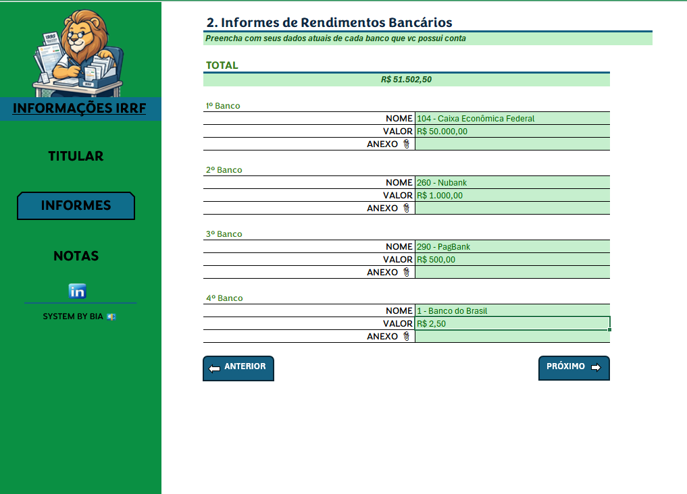
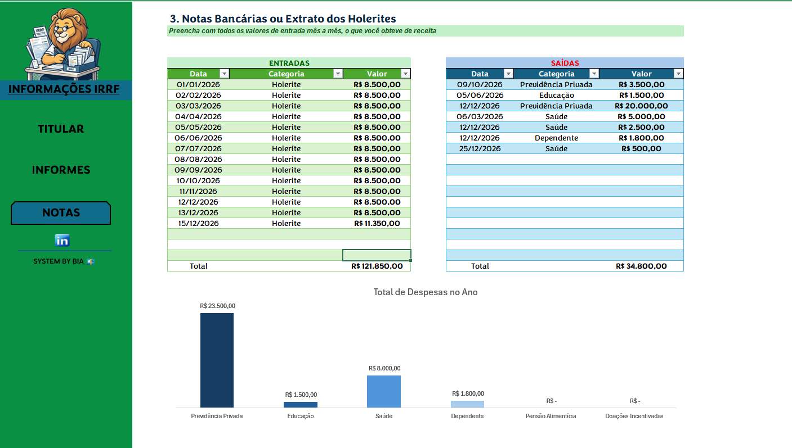

# 📊 Organizador de Imposto de Renda em Excel

## 📌 Sobre o projeto

Este projeto consiste no desenvolvimento de uma **ferramenta em Microsoft Excel para organização de informações necessárias à declaração de Imposto de Renda**.

A proposta é reunir, em um único ambiente, dados importantes para o processo de declaração, facilitando o registro, a consulta e a organização das informações financeiras do usuário.

O projeto foi desenvolvido como parte de um desafio prático da **DIO**, com foco na aplicação de recursos do Excel para criação de uma solução funcional, organizada e de fácil utilização.

## 🖼️ Demonstração da ferramenta

Abaixo são apresentadas algumas telas da ferramenta desenvolvida no Microsoft Excel para organização das informações utilizadas na declaração de Imposto de Renda.

### 🏠 Tela inicial

### 📋 Organização das informações

### 💰 Registro e controle de dados

## 🎯 Objetivo

O principal objetivo da ferramenta é auxiliar o usuário na **organização das informações utilizadas na declaração de Imposto de Renda**, centralizando os dados em uma planilha estruturada.

Além da aplicação prática dos conhecimentos de Excel, o projeto busca demonstrar como uma planilha eletrônica pode ser utilizada para transformar dados dispersos em informações organizadas e de fácil consulta.

## ⚙️ Funcionalidades

A ferramenta foi estruturada para facilitar o registro e a organização das informações necessárias ao processo de declaração, permitindo:

- 👤 Centralizar informações do titular;
- 🏦 Organizar informações bancárias e financeiras;
- 💰 Registrar valores e dados relacionados aos rendimentos;
- 📋 Reunir informações importantes em um único arquivo;
- 🔎 Facilitar a consulta aos dados cadastrados;
- 🧭 Utilizar uma estrutura organizada para navegação entre as informações;
- ✅ Reduzir erros de preenchimento por meio da organização e padronização dos dados.

## 🧮 Recursos do Excel utilizados

Durante o desenvolvimento do projeto foram aplicados diferentes recursos do Microsoft Excel, entre eles:

- Organização e estruturação de dados;
- Formatação de células e tabelas;
- Fórmulas e funções do Excel;
- Validação de dados;
- Padronização de campos de preenchimento;
- Recursos de navegação;
- Organização visual da interface;
- Estruturação de informações para facilitar consultas.

## 💻 Interface e usabilidade

Além dos cálculos e da organização das informações, o projeto também considera a experiência do usuário.

## 📚 Aprendizados

O desenvolvimento deste projeto possibilitou aplicar conhecimentos de Excel em uma situação prática, explorando a ferramenta não apenas como uma planilha para cálculos, mas como uma solução para organização e gerenciamento de informações.
Entre os principais aprendizados estão:
- Estruturação de dados no Excel;
- Organização de informações financeiras;
- Utilização de validações para melhorar o preenchimento;
- Construção de uma interface mais amigável;
- Aplicação prática de recursos e funções do Excel;
- Desenvolvimento de uma solução voltada para uma necessidade real;
- Documentação de um projeto utilizando GitHub e Markdown.

## ⚠️ Aviso importante

Este projeto possui finalidade exclusivamente educacional e foi desenvolvido para aplicação prática dos conhecimentos adquiridos durante o curso.
A ferramenta não substitui sistemas oficiais, profissionais contábeis ou orientações da Receita Federal.
Antes da publicação do arquivo em um repositório público, recomenda-se utilizar exclusivamente dados fictícios ou demonstrativos, evitando a exposição de CPF, endereço, dados bancários, rendimentos ou qualquer outra informação pessoal.

## 👩‍💻 Autora

Bianca A. G. Gonçalves de Araujo
Projeto desenvolvido como parte de um desafio prático de Excel e organização de dados.

A estrutura da planilha busca proporcionar uma utilização simples e intuitiva, facilitando a identificação dos campos que devem ser preenchidos e a navegação pelas diferentes áreas da ferramenta.

## 🛠️ Tecnologia utilizada

O projeto foi desenvolvido utilizando o **Microsoft Excel**, explorando recursos de organização, validação, automação e apresentação de dados.
